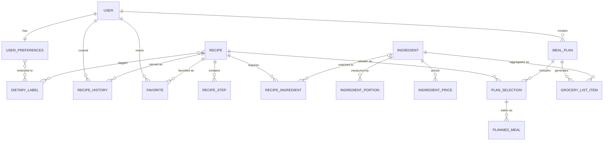

# Forkast Backend

Spring Boot API for Forkast. It owns all data access: recipes, ingredient matching, nutrition, pricing, dietary labels, meal plan generation, and grocery lists.

> **Status:** the data model, Flyway migrations (V1 to V10), authentication, user preferences, the recipe ingestion pipeline, recipe browsing, pricing and meal planning are complete. Live endpoints: `GET /api/health`, `GET /api/dietary-labels`, the 11 `/api/auth/*` routes, `GET`/`PATCH`/`DELETE /api/users/me`, `GET`/`POST`/`PUT /api/users/me/preferences`, recipe search, detail and favorites (with cost), the 9 `/api/meal-plans/*` routes, the 2 grocery list routes, the 5 `/api/admin/*` ingestion routes and the 4 `/api/admin/prices/*` routes. Scheduled jobs refresh Kroger prices weekly and make each user's plan at 11pm the night before their plan start day. Next: a larger recipe scrape and the catalog revisit.

## Local Setup

### Prerequisites

- JDK 17 or newer (must match `java.version` in `pom.xml`)
- A Supabase project (or any PostgreSQL database)
- VS Code with the Extension Pack for Java and Spring Boot Extension Pack (optional)

### Database configuration

Create `src/main/resources/application-local.properties`. This file is gitignored and must never be committed.

```properties
spring.datasource.url=jdbc:postgresql://<session-pooler-host>:5432/postgres
spring.datasource.username=postgres.<project-ref>
spring.datasource.password=<db-password>

spring.jpa.hibernate.ddl-auto=validate
spring.jpa.show-sql=true

# Generate with: openssl rand -base64 32
forkast.auth.jwt-secret=<base64 secret, at least 32 bytes>

# Admin API key for the data pipeline. Generate with: openssl rand -hex 32
# Must match FORKAST_ADMIN_KEY in data_pipeline/.env
forkast.admin.api-key=<64 hex characters>

# Supabase's session pooler allows 15 connections in total; leave room for tests and the dashboard
spring.datasource.hikari.maximum-pool-size=5

# Kroger developer app (client credentials). Same values as KROGER_* in data_pipeline/.env
forkast.pricing.kroger.client-id=<client id>
forkast.pricing.kroger.client-secret=<client secret>

# Restart only when this file changes, so saving a half-written migration doesn't run it
spring.devtools.restart.trigger-file=.reloadtrigger
```

The committed `application.properties` contains:

```properties
spring.profiles.active=local
spring.jpa.open-in-view=false

forkast.auth.access-token-ttl=15m
forkast.auth.refresh-token-ttl=90d
forkast.auth.code-ttl=15m
forkast.auth.code-max-attempts=5
```

Notes:

- Use Supabase's **Session pooler** connection. The direct connection is IPv6-only on the free tier, and the transaction pooler conflicts with JDBC prepared statements.
- Disable Supabase's Data API. This backend owns all data access.
- `ddl-auto` must stay `validate`. Flyway owns the schema; Hibernate only checks that entities match it.
- The app refuses to start if `forkast.auth.jwt-secret` is missing or shorter than 32 bytes, or if `forkast.admin.api-key` is shorter than 32 characters (`AdminProperties` needs `@NotBlank` as well as `@Size(min = 32)` to also reject a missing key).
- Keep the pool small. The dev server and the test suite each open a pool, and with the default of 10 connections each they exceed Supabase's 15-client session limit (`EMAXCONNSESSION`).
- Without Kroger credentials the app still starts; the weekly refresh logs that Kroger is off and `POST /api/admin/prices/refresh` returns 400. Prices then come only from imports (BLS, seed). The other pricing settings have defaults; see Pricing.
- The `local` profile enables `LoggingEmailService`, which prints verification and reset codes to the console instead of sending email. Without the `local` profile there is no email service yet, so the app will not start.

### Run

From this folder:

```bash
./mvnw spring-boot:run        # Git Bash / macOS / Linux
mvnw.cmd spring-boot:run      # Windows cmd/PowerShell
```

On startup, Flyway applies any pending migrations to an empty database, so no manual schema setup is needed. Verify at `http://localhost:8080/api/health`.

## Schema Management (Flyway)

The schema is defined by versioned SQL migrations in `src/main/resources/db/migration/`:

| Migration                            | Contents                                                                                                                                                                                                                                                                                                                                                                       |
| ------------------------------------ | ------------------------------------------------------------------------------------------------------------------------------------------------------------------------------------------------------------------------------------------------------------------------------------------------------------------------------------------------------------------------------ |
| `V1__initial_schema.sql`             | All 16 domain tables, constraints, indexes, and foreign keys                                                                                                                                                                                                                                                                                                                   |
| `V2__auth.sql`                       | `users.is_verified`, `password_changed_at`, `last_login_at`; `refresh_tokens` and `auth_codes` tables                                                                                                                                                                                                                                                                          |
| `V3__cascade_user_deletes.sql`       | Foreign keys to `users` (and their children) cascade on delete, for account deletion                                                                                                                                                                                                                                                                                           |
| `V4__seed_dietary_labels.sql`        | Inserts the 10 starter dietary labels                                                                                                                                                                                                                                                                                                                                          |
| `V5__preferences_meal_slots.sql`     | `user_preferences.plan_start_day` and `prefers_meal_prep`; `user_meal_slots` table                                                                                                                                                                                                                                                                                             |
| `V6__recipe_pipeline.sql`            | `pg_trgm` (in the `extensions` schema); recipe source, image, category, cuisine, keywords, meal-prep score and per-serving nutrition columns; `ingredient_aliases` and `ingredient_tags` tables; trigram indexes on ingredient names and aliases; `parsed_name` and `match_score` on `recipe_ingredients`                                                                      |
| `V7__recipe_ingredient_position.sql` | `recipe_ingredients.position`, backfilled per recipe in insert order, so lines come back in the order the recipe lists them                                                                                                                                                                                                                                                    |
| `V8__pricing.sql`                    | `ingredient_products` table (which store product stands in for each ingredient); `KROGER`, `BLS`, `SEED` price sources (V1's unnamed check is found and replaced); `promo_price`, `external_id`, `size_text`, `sold_by`, `price_per_100g`, `price_per_item` on `ingredient_prices`; `cost_per_serving` and `cost_complete` on `recipes`                                        |
| `V9__meal_plans.sql`                 | `plan_selections` table; `planned_meals` rebuilt around dates and selections; generation seed, usage and grocery cost, over-budget flag, open meals, generated-at and source on `meal_plans`; package, pantry and need-to-buy columns on `grocery_list_items`; slot scores on `recipes`; `ingredients.pantry_staple`; `user_preferences.leftovers_for_lunch`; `users.timezone` |
| `V10__plan_history.sql`              | `meal_plans.history_recorded_at`, so the weekly job writes each ended plan's recipe history once                                                                                                                                                                                                                                                                               |

On startup, Flyway runs any migrations not yet recorded in the `flyway_schema_history` table, in version order. Hibernate then runs with `ddl-auto=validate` and refuses to start if an entity doesn't match the schema.

### Making a schema change

1. Add a new file: `V<next number>__<description>.sql` (capital V, two underscores), e.g. `V2__add_recipe_source_url.sql`.
2. Write the SQL (`alter table`, `create index`, seed `insert`s, etc.).
3. Update the matching entity.
4. Restart. Flyway applies the migration, then Hibernate validates the entity against it.

### Rules

- **Write the full SQL before the first save.** With DevTools running, saving a new migration file restarts the app and Flyway applies it immediately, even if it is still empty. An empty migration is recorded with checksum 0; fix it by deleting that row from `flyway_schema_history` and restarting.
- **Never edit a migration that has been applied** to any database you can't freely wipe. Flyway checksums each file and fails on startup if an applied one changes. Fix mistakes with a new migration.
- **Enum columns have check constraints** (e.g. `meal_slot in ('BREAKFAST','LUNCH','DINNER')`). Adding an enum value in Java also needs a migration that drops and recreates the constraint.
- **Foreign key columns are not indexed automatically** in Postgres. Add indexes in a migration if lookups by parent become slow.

### Resetting a local database

Drop every table in `public`, including `flyway_schema_history`, then restart. Flyway rebuilds the schema from V1 onward.

## Package Structure

```
src/main/java/com/forkast/backend/
├── auth/         AuthController, AuthService, TokenService, AuthCodeService,
│                 JwtAuthenticationFilter, AuthProperties, AuthenticatedUser,
│                 RefreshToken, AuthCode, AuthCodeType + repositories, dto/
├── common/       ValidationUtils, TokenHasher, MessageResponse, PageResponse,
│                 exception/ApiException, exception/GlobalExceptionHandler
├── config/       SecurityConfig, SecurityErrorHandler, JwtConfig,
│                 AdminProperties, ApiKeyAuthenticationFilter, ClockConfig
├── diet/         DietaryLabel, DietaryLabelRepository, DietaryLabelResponse,
│                 DietaryLabelController
├── favorite/     Favorite, FavoriteRepository, FavoriteService, FavoriteController
├── history/      RecipeHistory, RecipeHistoryRepository, LastServedAt
├── ingest/       Recipe pipeline: IngredientLineParser, ParsedLine, Unit,
│                 UnitConverter, NutritionCalculator, DietaryLabelClassifier,
│                 MealPrepClassifier, RecipeEnricher, RecipeImporter,
│                 RecipeIngestService, RecipeReprocessor, RecipeReprocessService,
│                 IngredientImportService, IngredientReviewService,
│                 ReviewLineRepository, admin controllers, request/response records
├── ingredient/   Ingredient, IngredientPortion, IngredientAlias, IngredientTag,
│                 IngredientPrice, IngredientProduct, PriceSource, SoldBy,
│                 IngredientMatcher, IngredientNames, MatchResult, SimilarityHit,
│                 IngredientRepository, IngredientAliasRepository,
│                 IngredientPriceRepository, IngredientProductRepository
├── mealplan/     MealPlan, PlanSelection, PlannedMeal, GroceryListItem, MealSlot,
│                 PlanSource, MealPlanRepository, MealPlanService,
│                 MealPlanEditService, MealPlanController, RecipeOptionLoader,
│                 PlanWeeks, LastServed, dto/
│   ├── planner/  PlanGenerator, WeekLayout, CandidateScorer, PlannerProperties,
│   │             PlanRequest, RecipeOption, GeneratedPlan, SlotRun, WeekShape,
│   │             Candidate (plain classes, no database)
│   ├── grocery/  GroceryListBuilder, GroceryPriceLoader, GroceryListService,
│   │             GroceryListController, GroceryListItemRepository, request/response
│   └── weekly/   WeeklyPlanJob, WeeklyPlanWorker, PlanTiming
├── email/        EmailService, LoggingEmailService (local profile)
├── pricing/      PackageSizeParser, UnitPriceCalculator, PriceResolver,
│                 CurrentPriceService, RecipeCostCalculator, RecipeCostService,
│                 RecipeCostBatch, PriceImportService, ProductMappingService,
│                 IngredientLookup, PricingProperties, AdminPriceController,
│                 request/response records
│   └── kroger/   KrogerClient, KrogerProperties, KrogerProduct, KrogerQuote,
│                 KrogerPriceWriter, KrogerRefreshService, KrogerRefreshScheduler
├── recipe/       Recipe, RecipeStep, RecipeIngredient, RecipeRepository,
│                 RecipeQueryService, RecipeController, RecipeDetailResponse
│   ├── fit/      RecipeFitEvaluator, FitTargets, RecipeNutrition, FitFlag, FitResult
│   ├── scale/    IngredientScaler, ScaledAmount
│   └── search/   RecipeSpecifications, RecipeSearchCriteria, RecipeSearchRequest,
│                 RecipeSort, RecipeSummaryResponse
├── user/         User, UserPreferences, UserRepository, UserPreferencesRepository,
│                 UserController, UserService, PreferencesController,
│                 PreferencesService, dto/
├── BackendApplication.java
└── HealthController.java

src/main/resources/
├── application.properties
├── application-local.properties   (gitignored)
└── db/migration/                  Flyway migrations
```

Code is organized **by feature**, not by layer. Each package will hold its own entities, repositories, services, controllers, and DTOs.

## Data Model

17 domain tables: 15 entity classes plus 2 plain join tables (`user_dietary_restrictions`, `recipe_dietary_labels`). Auth adds 2 more (`refresh_tokens`, `auth_codes`), described under Authentication.



### Modeling conventions

- **UUID primary keys** on every entity.
- **Protected no-arg constructor** for JPA; a public constructor takes only required fields, and optional fields use setters.
- **Setters validate** input through `common/ValidationUtils` (`requireText`, `trimToNull`, `requirePositive`, `requireNonNull`).
- **All `@ManyToOne` / `@OneToOne` relationships are lazy.**
- **Enums are stored as strings** (`@Enumerated(EnumType.STRING)`), never ordinals.
- **Money and quantities use `BigDecimal`**, never `double`.
- **Request DTOs use wrapper types** (`Integer`, `Boolean`). Jackson 3 rejects a missing primitive with a generic "Failed to read request"; required fields use `@NotNull` instead.
- **Parent-owned children** (steps, recipe ingredients, portions, plan selections and their planned meals, grocery items) use `cascade = ALL` + `orphanRemoval`, with `add`/`remove` helpers on the parent that keep both sides in sync. Child setters for the parent are package-private.
- **Unbounded or shared relationships are one-way.** `User` and `Recipe` have no collections of favorites, history, or plans, and `Ingredient` has no price collection; those are queried through repositories.
- **Collection getters return unmodifiable views**, so changes go through helper methods.
- **Historical records are immutable** (`IngredientPrice`, `Favorite`, `RecipeHistory`): no setters, `updatable = false` columns. A changed price is a new row.

### user

**User** (`users`)

| Field                 | Type    | Notes                                                                                                     |
| --------------------- | ------- | --------------------------------------------------------------------------------------------------------- |
| id                    | UUID    | PK                                                                                                        |
| firstName             | String  | not null                                                                                                  |
| lastName              | String  | not null                                                                                                  |
| email                 | String  | unique, not null, trimmed and lowercased                                                                  |
| passwordHash          | String  | not null                                                                                                  |
| premium               | boolean | column `is_premium`, not null, default false                                                              |
| verified              | boolean | column `is_verified`, not null, default false                                                             |
| passwordChangedAt     | Instant | nullable; access tokens issued before it are rejected                                                     |
| lastLoginAt           | Instant | nullable                                                                                                  |
| timezone              | String  | IANA name, not null, default `America/New_York`; validated by `ZoneId`; when "11pm" is for the weekly job |
| createdAt / updatedAt | Instant | automatic timestamps                                                                                      |

**UserPreferences** (`user_preferences`, 1:1 with User)

| Field                 | Type                    | Notes                                                                                                   |
| --------------------- | ----------------------- | ------------------------------------------------------------------------------------------------------- |
| id                    | UUID                    | PK                                                                                                      |
| user                  | User                    | FK `user_id`, unique, not null                                                                          |
| weeklyBudget          | BigDecimal(10,2)        | not null; source of truth for budgeting                                                                 |
| householdServingSize  | int                     | not null, default 1                                                                                     |
| maxCaloriesPerMeal    | Integer                 | nullable = no limit                                                                                     |
| maxCaloriesPerDay     | Integer                 | nullable                                                                                                |
| proteinTargetGrams    | Integer                 | nullable                                                                                                |
| carbsTargetGrams      | Integer                 | nullable                                                                                                |
| fatTargetGrams        | Integer                 | nullable                                                                                                |
| repeatAvoidanceDays   | int                     | not null, default 14; checked against RecipeHistory                                                     |
| planStartDay          | DayOfWeek               | not null, default SUNDAY; first day of each meal plan                                                   |
| prefersMealPrep       | boolean                 | not null, default false; raises the weight of recipes' meal-prep score                                  |
| leftoversForLunch     | boolean                 | not null, default false; each dinner also covers the next day's lunch (needs a lunch slot)              |
| mealSlots             | Map\<MealSlot, Integer> | `@ElementCollection` in `user_meal_slots`; distinct recipes per week, 1 to 7; a missing slot is skipped |
| dietaryRestrictions   | Set\<DietaryLabel>      | M:N via `user_dietary_restrictions`                                                                     |
| createdAt / updatedAt | Instant                 | automatic timestamps                                                                                    |

### diet

**DietaryLabel** (`dietary_labels`): `id`, `name` (unique, not null, trimmed). Shared by UserPreferences and Recipe, so it lives in its own package. Labels are assigned to recipes at ingestion by a rule-based classifier (see Services).

### recipe

**Recipe** (`recipes`)

| Field                                                                    | Type                    | Notes                                                                                 |
| ------------------------------------------------------------------------ | ----------------------- | ------------------------------------------------------------------------------------- |
| id                                                                       | UUID                    | PK                                                                                    |
| name                                                                     | String                  | not null                                                                              |
| description                                                              | String (text)           | nullable                                                                              |
| prepTimeMinutes                                                          | Integer                 | nullable, non-negative                                                                |
| cookTimeMinutes                                                          | Integer                 | nullable, non-negative                                                                |
| totalTimeMinutes                                                         | Integer                 | **derived** in the getter (prep + cook), not stored                                   |
| baseServings                                                             | int                     | not null, at least 1, not updatable                                                   |
| notes                                                                    | String (text)           | nullable                                                                              |
| sourceUrl / sourceHost                                                   | String                  | `source_url` unique; set together by `setSource`; ingestion skips URLs it already has |
| imageUrl, category, cuisine                                              | String                  | nullable, from the scrape                                                             |
| keywords                                                                 | String (text)           | nullable, comma-separated                                                             |
| mealPrepScore                                                            | int                     | 0 to 100, from `MealPrepClassifier`                                                   |
| breakfastScore, lunchScore, dinnerScore                                  | int                     | 0 to 100, from `SlotClassifier`; a recipe can fill a slot at 50 or more               |
| caloriesPerServing, proteinGPerServing, carbsGPerServing, fatGPerServing | BigDecimal(7,2)         | from `NutritionCalculator`; set together by `setNutrition`                            |
| nutritionComplete                                                        | boolean                 | true only when every required line converted to grams                                 |
| costPerServing                                                           | BigDecimal(8,2)         | estimated USD from `RecipeCostCalculator`; null when no line could be priced          |
| costComplete                                                             | boolean                 | true only when every required line was priced; set with `costPerServing` by `setCost` |
| steps                                                                    | List\<RecipeStep>       | ordered by stepNumber                                                                 |
| ingredients                                                              | List\<RecipeIngredient> | ordered by `position`; `addIngredient` numbers each line                              |
| dietaryLabels                                                            | Set\<DietaryLabel>      | M:N via `recipe_dietary_labels`                                                       |
| createdAt / updatedAt                                                    | Instant                 | automatic timestamps                                                                  |

**RecipeStep** (`recipe_steps`): `id`, `recipe` (FK), `stepNumber` (int, at least 1), `instructionText` (text, not null). Unique on `(recipe_id, step_number)`.

**RecipeIngredient** (`recipe_ingredients`): a join entity with extra columns.

| Field                 | Type             | Notes                                                                    |
| --------------------- | ---------------- | ------------------------------------------------------------------------ |
| id                    | UUID             | PK                                                                       |
| recipe                | Recipe           | FK, not null                                                             |
| ingredient            | Ingredient       | FK, **nullable** (unmatched rows pending review)                         |
| amount                | BigDecimal(10,3) | **nullable** ("salt to taste"); positive when set                        |
| unit                  | String           | not null                                                                 |
| optional              | boolean          | column `is_optional`, default false                                      |
| prepNote              | String           | nullable (chopped, room temperature, etc.)                               |
| position              | int              | not null, from 1; the line's place in the recipe                         |
| rawText               | String (text)    | not null; the original unparsed line                                     |
| parsedName            | String           | nullable; the name the parser read, used for matching and review         |
| matchScore            | BigDecimal(4,3)  | nullable; 1.000 for exact or manual matches, else the best trigram score |
| needsReview           | boolean          | default false; true on construction until matched                        |
| createdAt / updatedAt | Instant          | automatic timestamps                                                     |

Matching is done through `matchIngredient(ingredient, score)` (links and clears `needsReview`), `flagForReview(bestScore)` and `unmatchIngredient()` (unlink and flag for review), so the ingredient, score and flag can't disagree. `unit` is stored as the lowercase name of the `Unit` enum (`cup`, `fl_oz`, `to_taste`). The same ingredient may appear twice in one recipe (e.g. sugar in dough and glaze), so there is no unique constraint on `(recipe_id, ingredient_id)`.

### ingredient

**Ingredient** (`ingredients`): the FoodData Central-backed catalog.

| Field                 | Type                     | Notes                                                                                                                                                                |
| --------------------- | ------------------------ | -------------------------------------------------------------------------------------------------------------------------------------------------------------------- |
| id                    | UUID                     | PK                                                                                                                                                                   |
| fdcId                 | Long                     | unique, nullable (custom ingredients have none)                                                                                                                      |
| name                  | String                   | not null, lowercased                                                                                                                                                 |
| caloriesPer100g       | BigDecimal(7,2)          | nullable = unknown                                                                                                                                                   |
| proteinGPer100g       | BigDecimal(7,2)          | nullable                                                                                                                                                             |
| carbsGPer100g         | BigDecimal(7,2)          | nullable                                                                                                                                                             |
| fatGPer100g           | BigDecimal(7,2)          | nullable                                                                                                                                                             |
| portions              | List\<IngredientPortion> | ordered by gram weight                                                                                                                                               |
| aliases               | Set\<IngredientAlias>    | other names that match exactly ("garlic cloves" for garlic); alias text is globally unique                                                                           |
| pantryStaple          | boolean                  | salt, oils, vinegars, dried spices, flour, sugar, leaveners: the grocery list's "check your pantry" group, counted at usage cost                                     |
| tags                  | Set\<IngredientTag>      | `@ElementCollection` in `ingredient_tags`: MEAT, POULTRY, FISH, SHELLFISH, DAIRY, EGG, GLUTEN, TREE_NUT, PEANUT, SOY, HONEY, GELATIN; dietary labels come from these |
| createdAt / updatedAt | Instant                  | automatic timestamps                                                                                                                                                 |

**IngredientPortion** (`ingredient_portions`): `id`, `ingredient` (FK), `description` (the weight of ONE unit, e.g. "cup, chopped" or "large"), `gramWeight` (BigDecimal(8,2), positive). Unique on `(ingredient_id, description)`. This is the density table for volume-to-mass conversion, sourced from FDC `foodPortions`.

**IngredientPrice** (`ingredient_prices`): immutable price observation. A new price is a new row, so the table is the price history.

| Field        | Type             | Notes                                                              |
| ------------ | ---------------- | ------------------------------------------------------------------ |
| id           | UUID             | PK                                                                 |
| ingredient   | Ingredient       | FK, not null                                                       |
| storeName    | String           | nullable ("Kroger 01400513", "BLS U.S. city average")              |
| price        | BigDecimal(10,2) | positive; the regular price                                        |
| promoPrice   | BigDecimal(10,2) | nullable; the sale price, when there is one                        |
| quantity     | BigDecimal(10,3) | positive; the amount the price buys                                |
| unit         | String           | not null; lowercase `Unit` name (`lb`, `fl_oz`, `count`)           |
| currency     | String(3)        | ISO code, uppercased                                               |
| source       | PriceSource      | `OPEN_PRICES`, `MANUAL`, `KROGER`, `BLS` or `SEED`                 |
| externalId   | String           | nullable; the source's id (Kroger product id, BLS series id)       |
| sizeText     | String           | nullable; the size as the source wrote it ("3 lb", "30 fo")        |
| soldBy       | SoldBy           | nullable; Kroger's `WEIGHT` (price per lb) or `UNIT` (per package) |
| pricePer100g | BigDecimal(10,4) | nullable; computed when stored                                     |
| pricePerItem | BigDecimal(10,4) | nullable; computed when stored                                     |
| recordedAt   | Instant          | when the price was observed (not when the row was saved)           |

Indexed on `(ingredient_id, recorded_at)`. Built with `IngredientPrice.builder(ingredient, source, price, quantity, unit)` and named calls for the optional fields; `manual(...)` remains for user-entered prices. A row with neither unit price (a size that couldn't be read) is kept for the record but never used for cost.

**IngredientProduct** (`ingredient_products`): which product at a source stands in for an ingredient (Kroger product `0000000004093` for onion). `id`, `ingredient` (FK, cascade), `source`, `externalId`, `label`, `active`, timestamps. Unique on `(ingredient_id, source, external_id)`, so an ingredient can have backups but the same product only once. Switching a product off (`deactivate()`) keeps its price history but stops it counting (see Pricing).

### favorite

**Favorite** (`favorites`): immutable. `id`, `user` (FK), `recipe` (FK), `createdAt`. Unique on `(user_id, recipe_id)`. Unfavoriting deletes the row.

### history

**RecipeHistory** (`recipe_history`): immutable. `id`, `user` (FK), `recipe` (FK), `servedAt` (passed in, not automatic). Indexed on `(user_id, served_at)`. Written by the weekly job once a plan's week has ended (one row per selection, dated noon on its cook day in the user's timezone); with earlier plans' cook dates it feeds the repeat-avoidance window.

### mealplan

A plan is a week of **selections** (recipe choices, each cooked once and eaten over one or more days) with a dated **calendar** of planned meals under them. Lock, swap and regenerate act on selections. The full design is in the Forkast Meal Plan Generator Plan doc.

**MealPlan** (`meal_plans`)

| Field                 | Type                   | Notes                                                                                         |
| --------------------- | ---------------------- | --------------------------------------------------------------------------------------------- |
| id                    | UUID                   | PK                                                                                            |
| user                  | User                   | FK, not null                                                                                  |
| weekStartDate         | LocalDate              | not null, not updatable; the user's plan start day; the plan runs 7 days (`getWeekEndDate()`) |
| budgetTarget          | BigDecimal(10,2)       | nullable; snapshot of the weekly budget at generation; edits hold the plan to it              |
| mealPrepMode          | boolean                | column `is_meal_prep_mode`; snapshot of `prefersMealPrep`                                     |
| source                | PlanSource             | `AUTO` (weekly job) or `MANUAL` (asked for)                                                   |
| generationSeed        | Long                   | the Random seed of the last draw, so it can be rebuilt                                        |
| generatedAt           | Instant                | when it was last drawn                                                                        |
| usageCost             | BigDecimal(10,2)       | what the week's meals use (sum of selection costs)                                            |
| groceryCost           | BigDecimal(10,2)       | what the shopping trip costs (whole packages; pantry staples at usage cost)                   |
| overBudget            | boolean                | groceryCost (usageCost until there's a list) over budgetTarget; set by `setCosts`             |
| openMeals             | int                    | slot-days no recipe covers (a count of 1, or too few recipes)                                 |
| historyRecordedAt     | Instant                | nullable; when the weekly job wrote its recipe_history (V10)                                  |
| selections            | List\<PlanSelection>   | returned by slot, then position                                                               |
| groceryItems          | List\<GroceryListItem> |                                                                                               |
| createdAt / updatedAt | Instant                | automatic timestamps                                                                          |

Unique on `(user_id, week_start_date)`: one plan per user per week. `getPlannedMeals()` flattens every selection's calendar rows by date, breakfast to dinner.

**PlanSelection** (`plan_selections`): one recipe choice.

| Field             | Type               | Notes                                                                  |
| ----------------- | ------------------ | ---------------------------------------------------------------------- |
| id                | UUID               | PK                                                                     |
| mealPlan          | MealPlan           | FK, not null, cascade                                                  |
| recipe            | Recipe             | FK, not null; changed by `assignRecipe` (swap, regenerate)             |
| mealSlot          | MealSlot           | `BREAKFAST`, `LUNCH`, `DINNER`                                         |
| position          | int                | 1..n within the slot, in date order                                    |
| startDate         | LocalDate          | the cook day                                                           |
| daysCovered       | int                | 1 to 7 (the layout keeps it to 3, or 4 for low counts)                 |
| servings          | int                | household x meals eaten (a leftover lunch adds one household)          |
| portionMultiplier | BigDecimal(6,3)    | servings / the recipe's base servings; exact, rounded only for display |
| estimatedCost     | BigDecimal(10,2)   | cost per serving x servings                                            |
| locked            | boolean            | a locked selection keeps its recipe when the plan is regenerated       |
| meals             | List\<PlannedMeal> | its calendar rows                                                      |

Unique on `(meal_plan_id, meal_slot, position)`. `hasStarted(today)` is true from its cook day: past and current meals are never changed.

**PlannedMeal** (`planned_meals`, rebuilt in V9): one calendar row. `id`, `mealPlan` (FK, cascade), `selection` (FK, cascade), `mealDate`, `mealSlot`, `leftover` (false on the cook day). Unique on `(meal_plan_id, meal_date, meal_slot)`. A dinner selection can own the next day's lunch row, so the row's slot can differ from its selection's. `getRecipe()` comes from the selection.

**GroceryListItem** (`grocery_list_items`)

| Field         | Type             | Notes                                                                     |
| ------------- | ---------------- | ------------------------------------------------------------------------- |
| id            | UUID             | PK; kept when the list is rebuilt, so the app's ticks survive a swap      |
| mealPlan      | MealPlan         | FK, not null                                                              |
| ingredient    | Ingredient       | FK, not null                                                              |
| totalAmount   | BigDecimal(10,3) | positive; exact (grams for weights)                                       |
| unit          | String           | `g` for combined weights, else the recipe unit (`count`, `can`)           |
| estimatedCost | BigDecimal(10,2) | what the line adds to the grocery cost; null when it can't be priced      |
| packageCount  | Integer          | whole packages to buy; null for by-weight items and lines with no product |
| packageLabel  | String           | the Kroger product and size                                               |
| packagePrice  | BigDecimal(10,2) | per package, or per lb for by-weight items; null = estimate               |
| pantry        | boolean          | a pantry staple: listed apart, counted at usage cost                      |
| needToBuy     | boolean          | the user needs this staple, so it counts at its full package price        |
| purchased     | boolean          | default false; `markPurchased()` / `markUnpurchased()`                    |

Unique on `(meal_plan_id, ingredient_id, unit)`, so shared ingredients combine into one line.

## Entity Helpers

Entity methods only touch data the entity (and its loaded associations) already holds. Anything that needs a repository, `PasswordEncoder`, or external API belongs in a service, because Hibernate creates entities outside Spring's bean lifecycle.

| Entity            | Implemented                                                                                                                                                                       | Planned                                                                                   |
| ----------------- | --------------------------------------------------------------------------------------------------------------------------------------------------------------------------------- | ----------------------------------------------------------------------------------------- |
| Recipe            | `getTotalTimeMinutes()`, add/remove for steps, ingredients, labels, `setSource()`, `setNutrition()`, `setMealPrepScore()`, `setCost()`                                            | `scaleIngredientsTo(servings)`, `nutritionPerServing()`, `matchesAllRestrictions(labels)` |
| RecipeIngredient  | `matchIngredient(ingredient, score)`, `flagForReview(score)`, `unmatchIngredient()`                                                                                               | `scaledAmount(multiplier)`, `convertTo(unit)`, `nutritionContribution()`                  |
| Ingredient        | `addPortion()`, `removePortion()`, `replacePortions()`, `addAlias()`, `replaceTags()`                                                                                             | `gramsForPortion(description)`, `gramWeightForUnit(unit)`                                 |
| IngredientPrice   | `builder(...)`, `manual(...)`, `hasUnitPrice()`                                                                                                                                   |                                                                                           |
| IngredientProduct | `activate()`, `deactivate()`, `setLabel()`                                                                                                                                        |                                                                                           |
| UserPreferences   | `replaceDietaryRestrictions()`, `replaceMealSlots()`, `setWeeklyBudget()` (normalized to 2 decimals)                                                                              | `hasNutritionConstraints()`, `isCompatibleWith(recipe)`, `perMealBudget(mealCount)`       |
| MealPlan          | `addSelection()`, `recordGeneration(seed, at)`, `setCosts(usage, grocery, openMeals)`, `markHistoryRecorded()`, `getPlannedMeals()`, `getWeekEndDate()`, grocery add/remove/clear | `totalNutrition()`                                                                        |
| PlanSelection     | `assignRecipe(recipe, servings, multiplier, cost)`, `addMeal(date, slot, leftover)`, `lock()`/`unlock()`, `hasStarted(today)`, `getLastMealDate()`                                |                                                                                           |
| PlannedMeal       | `getRecipe()` (through its selection)                                                                                                                                             | `nutritionTotal()`                                                                        |
| GroceryListItem   | `updateAmount()`, `addAmount()`, `setPackage()`, `setPantry()`, `setNeedToBuy()`, `markPurchased()`, `markUnpurchased()`                                                          |                                                                                           |
| User              | `changePassword()`, `changeEmail()`, `markVerified()`, `recordLogin()`, `setTimezone()`, `getZoneId()`                                                                            |                                                                                           |
| RefreshToken      | `isExpired(now)`                                                                                                                                                                  |                                                                                           |
| AuthCode          | `isExpired(now)`, `isLocked(max)`, `recordFailedAttempt()`                                                                                                                        |                                                                                           |

Optional ingredients (`RecipeIngredient.optional = true`) will be excluded from grocery aggregation, cost totals, and nutrition totals, and listed separately as optional additions.

## Repositories

| Repository                    | Custom queries                                                                                                                                                                                                                                                                        |
| ----------------------------- | ------------------------------------------------------------------------------------------------------------------------------------------------------------------------------------------------------------------------------------------------------------------------------------- |
| UserRepository                | `findByEmail`, `existsByEmail`                                                                                                                                                                                                                                                        |
| UserPreferencesRepository     | `findByUserId`, `existsByUserId`, `findAllWithUser` (fetch join, for the weekly job)                                                                                                                                                                                                  |
| DietaryLabelRepository        | `findAllByOrderByNameAsc`, `findByNameIgnoreCase`                                                                                                                                                                                                                                     |
| RecipeRepository              | `findByNameContainingIgnoreCase`, `existsBySourceUrl`, `findAllIds`, `JpaSpecificationExecutor` for search, `findWithLabelsByIdIn` and `findWithIngredientsById` (fetch joins)                                                                                                        |
| IngredientRepository          | `findByFdcId`, `findByNameIgnoreCase`, `findByName`, `findMostSimilar` (native, trigram similarity across names and aliases)                                                                                                                                                          |
| IngredientAliasRepository     | `findByAlias`                                                                                                                                                                                                                                                                         |
| ReviewLineRepository (ingest) | `findNeedsReview` (paged JPQL that builds `ReviewLineResponse` directly), `findByNeedsReviewTrueAndParsedName`, `findAllRecipeIds`                                                                                                                                                    |
| IngredientPriceRepository     | `findFirstByIngredientIdOrderByRecordedAtDesc`, `findByIngredientIdOrderByRecordedAtDesc`, `findByIngredientIds` (one query for many ingredients), the import's duplicate checks                                                                                                      |
| IngredientProductRepository   | `findActiveWithIngredient(source)` (fetch join, for the refresh), `findByIngredientIdAndSource`, `findByIngredientIdAndSourceAndExternalId`, `findByActiveFalse`                                                                                                                      |
| FavoriteRepository            | `existsByUserIdAndRecipeId`, `deleteByUserIdAndRecipeId`, `findFavoritedRecipeIds` (one query per page), `findRecipeIdsNewestFirst`, `insertIfAbsent` (native `on conflict do nothing`)                                                                                               |
| RecipeHistoryRepository       | `findTop20ByUserIdOrderByServedAtDesc`, `findByUserIdAndServedAtAfter`, `findRecentRecipeIds`, `findLastServed` (latest row per recipe, for the planner)                                                                                                                              |
| MealPlanRepository            | `findByUserIdAndWeekStartDate`, `existsByUserIdAndWeekStartDate`, `findByUserIdOrderByWeekStartDateDesc`, `findByUserId` (paged), `findByIdAndUserId` (owner only), the plan covering a date, `findLastPlannedDates` (latest cook date per recipe), `findIdsWithoutHistoryStartingBy` |
| GroceryListItemRepository     | `findByIdAndMealPlanUserId` (owner only)                                                                                                                                                                                                                                              |
| RefreshTokenRepository        | `findByTokenHash`, `deleteAllByUserId` (single `DELETE`)                                                                                                                                                                                                                              |
| AuthCodeRepository            | `findByUserIdAndType`, `deleteByUserIdAndType` (single `DELETE`)                                                                                                                                                                                                                      |

Child entities (RecipeStep, RecipeIngredient, IngredientPortion, PlanSelection, PlannedMeal) have no repositories; they are saved through their parent via cascade. GroceryListItem is saved the same way, and has a repository only so one line can be found by id.

## Services

Built:

- `AuthService`: signup, verification, login, refresh, logout, password reset and update, email change.
- `TokenService`: signs access JWTs, issues, rotates and revokes refresh tokens.
- `AuthCodeService`: issues and consumes 6-digit codes; failed attempts commit in their own transaction (`REQUIRES_NEW`, `noRollbackFor`) so they survive the error.
- `UserService`: current user, name updates, `UserResponse` mapping, account deletion.
- `PreferencesService`: get, create (409 if present), replace (PUT); a shared `apply` copies the request, validates dietary label ids and the calorie cross-field rule.
- `IngredientImportService`: creates or updates catalog ingredients by `fdcId`; aliases are add-only so review-queue aliases survive re-imports.
- `RecipeIngestService` + `RecipeImporter`: batch ingestion with one transaction per recipe (see Recipe Ingestion).
- `IngredientReviewService`: the review queue and manual matching.
- `RecipeReprocessService` + `RecipeReprocessor`: re-parse and re-match saved recipes from their raw text.
- `RecipeQueryService`: search, detail with scaling, the favorites list, and `requireVisible` (404 for a missing or restricted recipe).
- `FavoriteService`: idempotent add and remove.
- `CurrentPriceService`, `RecipeCostService`, `PriceImportService`, `ProductMappingService`, `KrogerRefreshService`: see Pricing.
- `MealPlanService`, `MealPlanEditService`, `GroceryListService`, `WeeklyPlanWorker`: see Meal Planning.

## Recipe Ingestion

The Python side is documented in [../data_pipeline/README.md](../data_pipeline/README.md). The scripts only fetch and forward raw data; every interpretation happens here, so parsing rules live in one place and saved recipes can be re-processed after a fix without re-scraping.

### Ingredient catalog

About 150 curated ingredients from `data_pipeline/ingredients_seed.csv`, each mapped to one USDA FoodData Central food (SR Legacy preferred for its household portions). `POST /api/admin/ingredients/import` creates or updates them by `fdcId`, replacing macros, portions and tags and adding aliases.

### Per recipe

`RecipeIngestService` loops the batch and calls `RecipeImporter.importRecipe` for each recipe in its own transaction (`REQUIRES_NEW`, in a separate bean so the proxy applies). A bad recipe rolls back alone and is listed in `failed`.

1. Skip the recipe if its `sourceUrl` already exists.
2. Reject it if `yields` has no serving count, or it has no ingredients or instructions.
3. Save steps in order.
4. Parse each line with `IngredientLineParser`; section headers ("For the sauce:") are dropped.
5. Match each parsed name with `IngredientMatcher`; weak matches are saved with `needsReview = true`.
6. `RecipeEnricher` computes nutrition, dietary labels, the meal-prep score and the cost per serving.

### Parser

`IngredientLineParser` turns one line into `ParsedLine(amount, unit, name, prepNote, optional, skip)`:

| Input                                     | Amount                   | Unit     | Name                             | Prep note |
| ----------------------------------------- | ------------------------ | -------- | -------------------------------- | --------- |
| `1 1/2 tsp salt`                          | 1.5                      | TSP      | salt                             |           |
| `½ cup sugar`                             | 0.5                      | CUP      | sugar                            |           |
| `2-3 cloves garlic, minced`               | 3 (upper end of a range) | CLOVE    | garlic                           | minced    |
| `1 (15 oz) can black beans, drained`      | 15                       | OZ       | black beans                      | drained   |
| `1 10oz. can diced tomatoes`              | 10                       | OZ       | diced tomatoes                   |           |
| `3 large eggs`                            | 3                        | COUNT    | eggs                             | large     |
| `1 lb. boneless, skinless chicken breast` | 1                        | LB       | boneless skinless chicken breast |           |
| `1/4 packed cup basil leaves`             | 0.25                     | CUP      | basil leaves                     | packed    |
| `pinch salt`                              | 1                        | PINCH    | salt                             |           |
| `Salt and pepper to taste`                | none                     | TO_TASTE | salt and pepper                  |           |

Units are normalized to the `Unit` enum: TSP, TBSP, CUP, FL_OZ, PINT, QUART, GALLON, ML, L, OZ, LB, G, KG, PINCH, CLOVE, SLICE, CAN, COUNT, TO_TASTE. "T" is tablespoon and "t" is teaspoon. Descriptor words stay in the name; the matcher decides what to strip.

### Matcher

`IngredientNames.candidates` lists lookups from most to least specific: as written, singular, without descriptor words (chopped, fresh, boneless, cracked, reserved...), and that singular. "Ground" is not a descriptor, because ground beef and beef differ. `IngredientMatcher` tries each candidate as an exact name or alias (score 1.000), then takes the best `extensions.similarity` across all names and aliases. 0.5 or higher matches; lower leaves the line for review with its score.

### Calculators

All plain Java, unit-tested without a database.

- **UnitConverter:** mass units use fixed factors. Volume uses a portion in the same unit (preferring one that matches the prep note), else any volume portion scaled by millilitres. Items use the requested size ("large"), a portion named for the unit ("clove"), a typical size (medium, large, small), then the first single-item portion. Pinch and to-taste have no weight.
- **NutritionCalculator:** sum of grams x value per 100 g over required lines, divided by base servings. Optional, to-taste, pinch and no-amount lines are left out. `complete` is false if any required line can't be converted or its ingredient has no nutrients; partial totals are still stored.
- **DietaryLabelClassifier:** a label applies when no required ingredient carries a tag that rules it out (vegetarian: MEAT, POULTRY, FISH, SHELLFISH, GELATIN; vegan adds DAIRY, EGG, HONEY; and so on). Tag labels need every required line matched, because a wrong "gluten-free" is worse than a missing one. High-protein needs complete nutrition and 25 g or more protein per serving.
- **MealPrepClassifier:** starts at 40; +30 meal-prep keywords, +15 storage instructions, +15 soup/stew/chili/curry/casserole/bowl/bake dish types, +5 for 4+ servings; -25 "serve immediately", -15 fried or crispy, -15 leafy salads, avocado or raw fish; clamped to 0 to 100.

### Review and re-processing

- The review queue lists unmatched lines grouped by parsed name. Resolving a line with `saveAlias: true` saves its normalized name as an alias, matches every other queued line with the same name, and recomputes each affected recipe.
- Re-processing re-parses every saved line from `raw_text` and re-matches unmatched lines (all lines with `rematchAll=true`, which can undo manual matches saved without an alias), one transaction per recipe.

Nutrition is never taken from the scrape; it's computed from matched `Ingredient` rows so there is one source of truth.

### Tests

`./mvnw test` runs about 225 tests (pricing included). Parser, names, converter, calculators and classifiers are plain unit tests. `IngredientMatcherIntegrationTest` and `IngredientReviewServiceIntegrationTest` use `@SpringBootTest` with the `local` profile against the real database and seeded catalog; they roll back their changes. Every Spring test uses `@ActiveProfiles("local")` so they share one cached context (and one connection pool).

## Recipe Browsing

Every recipe route needs a Bearer token. The full design is in the Forkast Recipe Endpoints Plan doc.

- **Hard filter:** a recipe without every label in the user's dietary restrictions never appears, in search, detail (404) or favorites (hidden, not deleted).
- **Soft flags:** `RecipeFitEvaluator` compares per-serving nutrition with the user's **per-meal** targets and returns flags plus a sorting penalty: `OVER_MAX_CALORIES` (any amount over), `UNDER_PROTEIN_TARGET` (under 80%), `OVER_CARBS_TARGET` / `OVER_FAT_TARGET` (over 125%), `NUTRITION_INCOMPLETE`. Unset preferences raise nothing.
- **Search:** filters are JPA `Specification`s combined with `Specification.allOf`; `maxCost` (per serving) leaves out recipes with no cost, like `maxCalories`. `fit` and `time` sort in Java over all matches; `protein`, `calories`, `mealPrep`, `newest` and `cost` sort in SQL with nulls last.
- **Cost:** cards and detail show `costPerServing` and `costComplete`; detail adds `estimatedCost` (per serving x the servings asked for). A page's cards take two extra queries (labels by fetch join, favorites by `in`), never one per recipe.
- **Scaling:** `IngredientScaler` multiplies by `servings / baseServings` (default servings: the household size). Display amounts use cook-friendly fractions for volume and count units, whole numbers for g/ml, and 2 decimals for oz/lb/kg/l. Under 1/4 cup steps down to tablespoons, and under 1 tbsp to teaspoons.
- **Favorites:** `PUT` inserts with `on conflict do nothing`, so retries and races leave one row; `DELETE` always returns 204.

## Pricing

The full design and the test-run findings are in the Forkast Pricing Plan doc. The app never calls a price source while a user waits: prices are stored as `IngredientPrice` history, and recipes store their cost.

**Sources.**

| Source | How it arrives                                                                                        | Role                   |
| ------ | ----------------------------------------------------------------------------------------------------- | ---------------------- |
| Kroger | `KrogerRefreshService` re-prices every active `ingredient_products` row, one product per call, weekly | Live source            |
| BLS    | `import_prices.py bls`: US city-average prices for about 23 staples, dated at their month's end       | Fallback, sanity check |
| Seed   | `import_prices.py seed` from `prices_seed.csv`                                                        | Last resort for gaps   |

Prices come from one store, Kroger On the Rhine in Cincinnati (`01400513`), as one national estimate.

**Unit prices.** `PackageSizeParser` reads sizes ("3 lb", "16.9 fl oz", "30 fo", "1/2 gal", "12 ct", "12 x 12 fl oz"). `UnitPriceCalculator` turns price + size into a price per 100 g (grams from `UnitConverter`, the same conversion recipes use) and, for counts, a price per item. Kroger items sold by `WEIGHT` are priced per lb. Counted packages ("1 ct" celery) use the package weight Kroger gives and never the catalog's portions, which could be off twenty times (a bunch is not a celery strip). Loose produce gets a price per item from Kroger's average weight.

**Resolving a price.** `PriceResolver` picks one price per ingredient: Kroger within 14 days, then BLS within 60 days, then the newest real price (marked stale), then the seed price, then none. Within a step each product counts once with its latest price and the cheapest wins, per 100 g and per item separately. `CurrentPriceService` loads history in one query and drops prices of switched-off products, so a replaced wrong pick (lemon soda for lemons) stops counting at once.

**Recipe cost.** `RecipeCostCalculator` mirrors nutrition: the same lines count, each costs its grams x price per 100 g, a count line falls back to price per item, and water and ice are free. `costComplete` is false if any required line has no price or can't be converted; the stored number then covers the rest. It's the cost of what the recipe uses, not of whole packages (that's the grocery list). `RecipeEnricher` sets it on ingest, review and reprocess; `RecipeCostService` recalculates every recipe after an import or refresh, resolving prices once and updating 100 recipes per transaction.

**Settings** (all have defaults):

| Property                                  | Default                     | Meaning                                               |
| ----------------------------------------- | --------------------------- | ----------------------------------------------------- |
| `forkast.pricing.live-max-age`            | `14d`                       | How long a Kroger price counts as current             |
| `forkast.pricing.bls-max-age`             | `60d`                       | How long a BLS month counts as current                |
| `forkast.pricing.refresh-cron`            | `0 0 6 * * MON`             | Weekly refresh, Eastern time; `-` turns it off        |
| `forkast.pricing.kroger.base-url`         | `https://api-ce.kroger.com` | Certification; `https://api.kroger.com` in production |
| `forkast.pricing.kroger.location-id`      | `01400513`                  | The store prices come from                            |
| `forkast.pricing.kroger.request-delay-ms` | `250`                       | Pause between product calls                           |

**Product mapping.** `data_pipeline/find_product.py` searches Kroger, writes the best guess per ingredient to `kroger_products.csv` for review, and posts it to `/api/admin/prices/products` (see [../data_pipeline/README.md](../data_pipeline/README.md#prices)).

## Meal Planning

Every route needs a Bearer token, and someone else's plan or grocery line is a 404, like a missing one. The full design, with the decisions behind it, is in the Forkast Meal Plan Generator Plan doc.

**Slot fit.** `SlotClassifier` scores every recipe 0 to 100 for breakfast, lunch and dinner from its category tags, name and keywords; it runs on ingest and reprocess. A side dish, sauce or dressing scores 0 whatever else it's tagged; desserts and snacks only when no meal tag comes with them. A meal the site names outright (Breakfast, Lunch, Dinner) gets at least 60.

**Generating** (`MealPlanService.generate`, `PlanGenerator`). The generator is plain Java fed by `RecipeOptionLoader`, so every rule is unit-tested without a database:

1. **Lay out the week** (`WeekLayout`): each slot's count of recipes is split into consecutive runs, longest first (3 dinners: 3, 2 and 2 days). Runs are at most 3 days; a count too low to cover the week stretches to 4 days, and a count of 1 leaves 3 days open. With leftovers for lunch, each dinner also covers the next day's lunch and lunch recipes fill the rest.
2. **Pool candidates** (hard filters): the user's dietary restrictions, a known cost, a slot score of 50 or more, calories within the per-meal limit (unknown calories are left out when there's a limit), not served within the repeat window, and for a 4-day run a meal-prep score of 70 or more. A slot with too few recipes readmits the oldest-served first.
3. **Draw** weighted at random from the plan's seed, longest runs first, no recipe twice in a week. `CandidateScorer` multiplies slot fit, nutrition fit, a leftovers factor (meal-prep score), cost against the budget share, favorites (x1.5), recently served (x0.7) and incomplete cost (x0.85). A run nothing can fill is left open.
4. **Fit the budget**: while usage cost is over 90% of the weekly budget, the unlocked pick furthest over its share is swapped for the best-weighted cheaper recipe. A plan that still can't fit is saved and flagged, never refused.
5. **Save** selections with one calendar row per meal, and build the grocery list.

"Last served" is the later of the user's newest `recipe_history` row and the recipe's newest cook date in their earlier plans.

**Grocery list** (`GroceryListBuilder`, `GroceryListService`). Each selection's required, matched lines are scaled by its portion multiplier; weights add up per ingredient in grams, and counts with no weight on file keep their own line. Each line is bought from the ingredient's active Kroger product that's cheapest for the amount needed, in whole packages (up to 3% over a package still counts as that package); by-weight items cost exactly what's needed. Pantry staples count at what the week uses unless marked "need to buy", and lines with no product count at usage cost as an estimate. Water and ice are left off. The list is rebuilt in place after every edit, so line ids, `purchased` and `needToBuy` survive.

**Editing** (`MealPlanEditService`). Lock, swap, suggestions and regenerate act on one selection or all of them; a selection whose cook day is today or earlier is never changed (409). A user's own pick must pass the hard filters except the repeat window. Every edit recalculates usage cost and rebuilds the grocery list, and holds the plan to the budget it was made with.

**Weekly job** (`WeeklyPlanJob`, hourly). Makes next week's plan (`AUTO`) for every user whose local time is 11pm or later the night before their plan start day, who has a meal slot and no plan for that week yet. Only that last hour counts, so deleting a fresh plan doesn't bring it back. Then it writes `recipe_history` for plans whose week has ended everywhere (start date at least 8 days ago, UTC), once per plan. Each user and each plan is its own transaction.

**Settings** (`forkast.planner.*`, all with defaults):

| Property                 | Default        | Meaning                                                            |
| ------------------------ | -------------- | ------------------------------------------------------------------ |
| `max-run-days`           | `3`            | A recipe is eaten by the second day after it's cooked              |
| `stretch-run-days`       | `4`            | The longest a run gets when the count can't cover the week         |
| `stretch-min-meal-prep`  | `70`           | Only recipes that keep fill a stretched run                        |
| `budget-margin`          | `0.90`         | Usage cost must fit this share of the budget (packages cost more)  |
| `leftover-base`          | `0.40`         | Leftovers factor = base + (1 - base) x meal-prep score / 100       |
| `favorite-boost`         | `1.5`          |                                                                    |
| `recent-factor`          | `0.70`         | Served within twice the repeat window                              |
| `incomplete-cost-factor` | `0.85`         |                                                                    |
| `generate-at`            | `23:00`        | Local time the weekly plan is made, the night before the start day |
| `cron`                   | `0 20 * * * *` | When the job runs (minute 20 of every hour); `-` turns it off      |

## Authentication

Short-lived JWT access tokens plus hashed, database-stored refresh tokens, one per device. The full design and its reasoning are in the Forkast Auth Plan doc.

| Item               | Rule                                                                                                                                         |
| ------------------ | -------------------------------------------------------------------------------------------------------------------------------------------- |
| Access token       | JWT HS256, 15 minutes, claims `sub` (user id), `iat`, `exp`; sent as `Authorization: Bearer <token>`                                         |
| Refresh token      | 32 random bytes as hex, SHA-256 stored, 90 days, sent in the request body; rotated on every refresh                                          |
| Codes              | 6 digits emailed for verification, password reset and email change; SHA-256 stored, 15 minutes, locked after 5 wrong tries                   |
| Passwords          | BCrypt strength 12, 8 to 72 characters                                                                                                       |
| Session revocation | Password reset, password update and account deletion end every refresh token; access tokens issued before `password_changed_at` are rejected |
| Enumeration        | Resend-verification and forgot-password always return the same 202                                                                           |

**Request flow:** `JwtAuthenticationFilter` reads the Bearer token, verifies it with `JwtDecoder`, loads the user and checks `password_changed_at`. A valid token becomes an `AuthenticatedUser` principal (`@AuthenticationPrincipal` in controllers); an invalid one leaves the request unauthenticated. `SecurityConfig` then allows the public routes and requires authentication for everything else, so new routes are protected by default.

**Errors:** every error is an RFC 9457 ProblemDetail (`application/problem+json`) from `GlobalExceptionHandler`; validation failures add an `errors` map. Security rejections (401/403) are routed through `SecurityErrorHandler` to the same handler. A wrong current password returns 400, never 401, so the app's "401 means refresh" logic is not triggered.

**Tables:**

- `refresh_tokens`: `id`, `user_id` (cascade), `token_hash` (unique), `expires_at`, `created_at`.
- `auth_codes`: `id`, `user_id` (cascade), `type` (`EMAIL_VERIFY`, `PASSWORD_RESET`, `EMAIL_CHANGE`), `code_hash`, `new_email`, `attempts`, `expires_at`, `created_at`; unique on `(user_id, type)`.

## API Routes

| Method | Path                                                                                 | Auth    | Handler                   | Status                                                                                                                                                                                               |
| ------ | ------------------------------------------------------------------------------------ | ------- | ------------------------- | ---------------------------------------------------------------------------------------------------------------------------------------------------------------------------------------------------- |
| GET    | /api/health                                                                          | Public  | HealthController          | **live**                                                                                                                                                                                             |
| GET    | /api/dietary-labels                                                                  | Public  | DietaryLabelController    | **live**                                                                                                                                                                                             |
| POST   | /api/auth/signup                                                                     | Public  | AuthController            | **live** (201)                                                                                                                                                                                       |
| POST   | /api/auth/verify-email                                                               | Public  | AuthController            | **live**                                                                                                                                                                                             |
| POST   | /api/auth/resend-verification                                                        | Public  | AuthController            | **live** (202)                                                                                                                                                                                       |
| POST   | /api/auth/login                                                                      | Public  | AuthController            | **live**                                                                                                                                                                                             |
| POST   | /api/auth/refresh                                                                    | Public  | AuthController            | **live**                                                                                                                                                                                             |
| POST   | /api/auth/logout                                                                     | Public  | AuthController            | **live** (204)                                                                                                                                                                                       |
| POST   | /api/auth/forgot-password                                                            | Public  | AuthController            | **live** (202)                                                                                                                                                                                       |
| POST   | /api/auth/reset-password                                                             | Public  | AuthController            | **live**                                                                                                                                                                                             |
| PATCH  | /api/auth/password                                                                   | Bearer  | AuthController            | **live**                                                                                                                                                                                             |
| POST   | /api/auth/email-change                                                               | Bearer  | AuthController            | **live** (202)                                                                                                                                                                                       |
| POST   | /api/auth/email-change/confirm                                                       | Bearer  | AuthController            | **live**                                                                                                                                                                                             |
| GET    | /api/users/me                                                                        | Bearer  | UserController            | **live**                                                                                                                                                                                             |
| DELETE | /api/users/me                                                                        | Bearer  | UserController            | **live** (204)                                                                                                                                                                                       |
| PATCH  | /api/users/me                                                                        | Bearer  | UserController            | **live** (first and/or last name, `timezone`)                                                                                                                                                        |
| GET    | /api/users/me/preferences                                                            | Bearer  | PreferencesController     | **live** (404 until set up)                                                                                                                                                                          |
| POST   | /api/users/me/preferences                                                            | Bearer  | PreferencesController     | **live** (201; 409 if already set up)                                                                                                                                                                |
| PUT    | /api/users/me/preferences                                                            | Bearer  | PreferencesController     | **live** (replaces all fields; `null` = no limit)                                                                                                                                                    |
| GET    | /api/recipes?q=&labels=&minProtein=&maxCalories=&maxTime=&maxCost=&sort=&page=&size= | Bearer  | RecipeController          | **live** (page of summaries with `flags`, `favorite` and cost; `sort=cost` cheapest first)                                                                                                           |
| GET    | /api/recipes/{id}?servings=                                                          | Bearer  | RecipeController          | **live** (scaled detail with `estimatedCost`; 404 if missing or restricted)                                                                                                                          |
| PUT    | /api/recipes/{id}/favorite                                                           | Bearer  | FavoriteController        | **live** (204, idempotent)                                                                                                                                                                           |
| DELETE | /api/recipes/{id}/favorite                                                           | Bearer  | FavoriteController        | **live** (204, idempotent)                                                                                                                                                                           |
| GET    | /api/users/me/favorites?page=&size=                                                  | Bearer  | FavoriteController        | **live** (newest first)                                                                                                                                                                              |
| POST   | /api/admin/ingredients/import                                                        | API key | AdminIngredientController | **live** (`{ingredients: [...]}`, up to 50; `{created, updated}`)                                                                                                                                    |
| POST   | /api/admin/recipes/ingest                                                            | API key | AdminRecipeController     | **live** (`{recipes: [...]}`, up to 25; `{created, skippedDuplicate, failed, needsReview}`)                                                                                                          |
| GET    | /api/admin/recipe-ingredients/needs-review?page=&size=                               | API key | AdminReviewController     | **live** (`{items, page, size, total}`)                                                                                                                                                              |
| PATCH  | /api/admin/recipe-ingredients/{id}                                                   | API key | AdminReviewController     | **live** (`{ingredientId, saveAlias}`; `{id, ingredientName, alsoMatched}`)                                                                                                                          |
| POST   | /api/admin/recipes/reprocess?rematchAll=                                             | API key | AdminReviewController     | **live** (`{recipes, linesReparsed, newlyMatched, stillNeedsReview, failed}`)                                                                                                                        |
| POST   | /api/admin/prices/import                                                             | API key | AdminPriceController      | **live** (`{prices: [...]}`, up to 200; `{imported, skipped, failed, recipesRecosted}`)                                                                                                              |
| POST   | /api/admin/prices/products                                                           | API key | AdminPriceController      | **live** (`{products: [...]}`, up to 500; `{created, updated, unchanged, failed}`)                                                                                                                   |
| POST   | /api/admin/prices/refresh                                                            | API key | AdminPriceController      | **live** (re-prices every active Kroger product; `{products, priced, noUnitPrice, failed, recipesRecosted}`)                                                                                         |
| POST   | /api/admin/prices/recalculate                                                        | API key | AdminPriceController      | **live** (`{recipesRecosted}`)                                                                                                                                                                       |
| POST   | /api/meal-plans/generate                                                             | Bearer  | MealPlanController        | **live** (`{weekStart?}`, default the next plan start day; 201 with the plan; 409 if the week has one; 422 without preferences or meal slots; 400 for a week that's not on the start day or is over) |
| GET    | /api/meal-plans?page=&size=                                                          | Bearer  | MealPlanController        | **live** (summaries, newest week first)                                                                                                                                                              |
| GET    | /api/meal-plans/current                                                              | Bearer  | MealPlanController        | **live** (the plan covering today in the user's timezone; 404 if none)                                                                                                                               |
| GET    | /api/meal-plans/{id}                                                                 | Bearer  | MealPlanController        | **live** (selections, `days` calendar, `open` meals, costs, budget, `overBudget`)                                                                                                                    |
| DELETE | /api/meal-plans/{id}                                                                 | Bearer  | MealPlanController        | **live** (204)                                                                                                                                                                                       |
| POST   | /api/meal-plans/{id}/regenerate                                                      | Bearer  | MealPlanController        | **live** (redraws unlocked selections that haven't started; 409 if there are none)                                                                                                                   |
| PATCH  | /api/meal-plans/{id}/selections/{selectionId}                                        | Bearer  | MealPlanController        | **live** (`{locked}`; the plan)                                                                                                                                                                      |
| POST   | /api/meal-plans/{id}/selections/{selectionId}/swap                                   | Bearer  | MealPlanController        | **live** (`{recipeId}` to use it, no body to pick one; 400 if it can't fill the meal, 409 if already in the plan or the meal has started)                                                            |
| GET    | /api/meal-plans/{id}/selections/{selectionId}/suggestions                            | Bearer  | MealPlanController        | **live** (up to 5 recipes, best first, with `estimatedCost` and `costChange`)                                                                                                                        |
| GET    | /api/meal-plans/{id}/grocery-list                                                    | Bearer  | GroceryListController     | **live** (`toBuy` and `pantry` lines with packages and costs, `unlistedLines`; built on first read for older plans)                                                                                  |
| PATCH  | /api/grocery-list-items/{id}                                                         | Bearer  | GroceryListController     | **live** (`{purchased?, needToBuy?}`; 204; `needToBuy` only for pantry staples)                                                                                                                      |

Controllers stay thin (bind, validate, delegate to a service). Success responses return the DTO with an explicit status; errors return ProblemDetail. Recipe routes are Bearer-only, covered by `SecurityConfig`'s authenticated default. Admin routes require the `X-Admin-Key` header: `ApiKeyAuthenticationFilter` compares it in constant time and grants `ROLE_ADMIN`, and `/api/admin/**` requires that role, so a user's access token gets 403.

## Open Questions

- [x] Grocery pricing comes from Kroger (one store, weekly), BLS and seed prices, stored as `IngredientPrice` history and resolved by a fallback chain. Open Prices was dropped: too thin for meat, produce and store brands.
- [x] Dietary labels are assigned by a rule-based classifier at ingestion.
- [x] Schema is managed by Flyway migrations, with Hibernate in `validate` mode.
- [x] `Recipe` source and image columns added in V6; ingestion dedupes on `sourceUrl`.
- [x] Units: a normalized `Unit` enum, stored as its lowercase name.
- [x] `portionMultiplier` and grocery amounts are stored exact and rounded only for display.
- [ ] Allow more than one recipe per meal slot (main + side)? One per slot in v1; detecting recipes that need a side is listed in the Meal Plan Generator Plan doc.
- [x] `weekStartDate` is the user's own plan start day; a plan runs 7 days from it.
- [x] Auth adapted from the existing Express flow for mobile: emailed codes instead of links, refresh token in the body, per-device sessions, account deletion instead of deactivation.
- [x] Meal choices stored as slot to distinct-recipes-per-week counts; per-user plan start day; meal prep is a preference that weights a per-recipe score. Full design in the Forkast Users and Preferences Plan doc.
- [x] Meal plans: `plan_selections` + dated `planned_meals` (V9) support lock, swap, multi-day recipes and leftover lunches.
- [ ] Remember which pantry staples a user keeps, so they stop showing as "check your pantry"? Out of v1.
- [ ] Push notifications when the weekly plan is ready? Out of v1.
- [x] `meal_prep_score` added in V6, computed by `MealPrepClassifier` at ingestion.
- [ ] Catalog revisit after a larger scrape: new rows (white wine, pecorino, capers, olives, pine nuts...), aliases for pasta shapes and oils, and cooked versions of rice, pasta and grains ("cooked white rice" currently matches raw rice).
- [ ] Use gram weights recipes give in parentheses ("1 cup (240g)") instead of portion lookups.
- [ ] Integration tests run against Supabase; move them to Testcontainers (throwaway Postgres in Docker).
- [ ] The review queue lists only unmatched lines; also list low-confidence fuzzy matches (score under about 0.8). "Cherry peppers" matched black pepper at 0.5+ and was never reviewed.
- [x] Recipe prices scraped from blogs are stripped by the parser; live prices come from the pricing service.
- [ ] Pricing follow-ups (fresh herbs in small packages, products with only a price per item, premium-brand picks, Kroger production approval) are listed in the Forkast Pricing Plan doc for the catalog revisit.
- [ ] Choose a production email provider, and send emails after the transaction commits.
- [ ] Rate-limit login and code endpoints before public launch.
- [ ] Scheduled cleanup of expired refresh tokens and auth codes.
